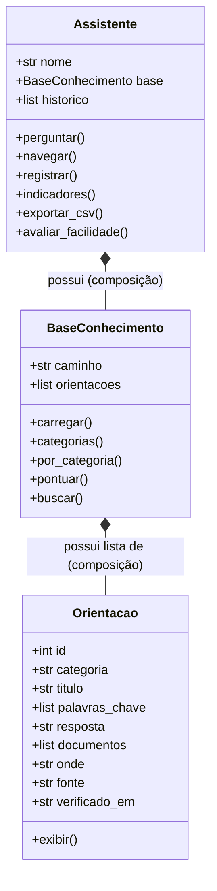

# Citizen Assist AI
### Assistente Digital de Orientação ao Cidadão
**FIAP - Global Solution 2026.2**  
**Disciplina:** Pensamento Computacional e Automação com Python (PCP)

---

## Integrantes da Equipe
* **ENZO SEIJI DELGADO TABUCHI** - RM: 573156
* **LUCA ALMEIDA LUCARELI** - RM: 569061
* **HENRIQUE ALMEIDA LUCARELI** - RM: 569183

---

## Público e Problema Escolhido
* **Público-alvo:** Jovens cidadãos em transição para a vida adulta e ingresso no primeiro emprego (15 a 24 anos).
* **Problema:** Ao buscar o primeiro emprego ou atingir a maioridade civil, jovens enfrentam grande desinformação e burocracia sobre emissão de documentos essenciais (Carteira de Trabalho Digital, CPF, Título de Eleitor, Alistamento Militar, Conta Gov.br) e programas de oportunidade (Jovem Aprendiz, cursos profissionalizantes, FGTS, PIS e ID Jovem). As informações oficiais encontram-se fragmentadas em múltiplos portais governamentais, com linguagem burocrática, havendo risco constante de sites falsos ou golpes que cobram por serviços que são 100% gratuitos.
* **Solução:** O **Citizen Assist AI** centraliza orientações oficiais, verificadas e em linguagem simples diretamente no terminal, sem exigir qualquer dado pessoal sensível do cidadão, indicando os documentos necessários, onde ir e a fonte oficial de checagem.

---

## Objetivos de Desenvolvimento Sustentável (ODS) Relacionados
1. **ODS 8 - Trabalho Decente e Crescimento Econômico:** Facilita a entrada de jovens no mercado de trabalho formal através de orientações sobre Carteira de Trabalho Digital, Jovem Aprendiz e qualificação profissional gratuita.
2. **ODS 10 - Redução das Desigualdades:** Democratiza o acesso a direitos e programas sociais (ID Jovem, Cartão SUS, Conta Gov.br, isenções) para jovens de baixa renda.
3. **ODS 16 - Paz, Justiça e Instituições Eficazes:** Garante acesso à identidade civil, documentação básica (CPF, Título de Eleitor, Alistamento) e transparência nas instituições públicas.

---

## Como Executar o Projeto

### Pré-requisitos
* Python 3.8 ou superior instalado.
* Nenhuma biblioteca externa é necessária (utiliza apenas os módulos nativos `json`, `csv`, `os`, `sys`, `time` e `datetime`).

### Passo a Passo
1. Clone ou baixe o repositório em sua máquina:
   ```bash
   git clone https://github.com/lucalucareli/gs-pcp-fiap-citizen-assist-ai
   cd cp-pcp-fiap-citizen-assist-ai
   ```
2. Certifique-se de que a estrutura de arquivos está completa:
   ```text
   citizen-assist-ai/
   ├── README.md
   ├── main.py
   ├── orientacao.py
   ├── base_conhecimento.py
   ├── assistente.py
   ├── ROTEIRO_VIDEO.md
   ├── entrega_fiap.txt
   └── data/
       ├── base_conhecimento.json
       ├── historico.json
       └── atendimentos.csv
   ```
3. Execute o programa principal:
   ```bash
   python main.py
   ```
   *(ou `python3 main.py` dependendo do seu sistema operacional)*

---

## Regra de Pontuação e Inteligência de Busca

A busca inteligente do assistente opera por regras baseadas em pontuação matemática e normalização textual:

### 1. Normalização de Texto
O texto da pergunta, títulos e palavras-chave passa pela função `normalizar()`:
* Conversão para minúsculas (`lower()`).
* Remoção de acentuação gráfica (`á, é, í, ó, ú, ç`, etc.).
* Eliminação de caracteres de pontuação (`?!.,;:()[]{}-_`).
* Inclusão de espaços nas extremidades para permitir buscas de termos exatos sem falsos positivos em substrings.

### 2. Tabela de Pontuação
| Critério | Pontos |
|---|---|
| Palavra-chave cadastrada na orientação que aparece na pergunta | **+3 pontos** |
| Palavra da pergunta (com 4 letras ou mais) presente no título | **+1 ponto** |

### 3. Níveis de Confiança
* **Confiança ALTA:** $\ge 6$ pontos.
* **Confiança MÉDIA:** $3$ a $5$ pontos.
* **Não Encontrado:** $< 3$ pontos (o assistente avisa que não encontrou com segurança e sugere outras palavras ou navegação por categorias).

### Exemplo Prático Real
Pergunta do usuário: *"Como faço o cartão do SUS?"*
* Orientação ID 11: *Fazer o Cartão Nacional de Saúde (Meu SUS Digital)*
  * Palavras-chave que casaram: `"cartao do sus"` (+3) e `"sus"` (+3).
  * Palavra da pergunta com 4+ letras no título: `"cartao"` (+1).
  * **Pontuação final:** $3 + 3 + 1 = 7$ pontos $\rightarrow$ **Confiança ALTA**.

---

## Arquitetura Orientada a Objetos e Composição

O sistema foi estruturado estritamente em Programação Orientada a Objetos com o princípio de responsabilidade única e composição:



1. **`Orientacao` (`orientacao.py`):** Modela cada serviço/registro público da base de conhecimento. Armazena metadados e é responsável por formatar e exibir na tela a resposta oficial e aviso legal.
2. **`BaseConhecimento` (`base_conhecimento.py`):** Agrega a coleção de objetos `Orientacao`. Lê com segurança o arquivo JSON, cataloga categorias e implementa a lógica do algoritmo de busca e pontuação.
3. **`Assistente` (`assistente.py`):** Conduz os diálogos com o cidadão, filtra e rejeita tentativas de envio de dados pessoais (LGPD), afere o tempo e tentativas de cada interação, calcula métricas de desempenho e persiste em `historico.json` e `atendimentos.csv`.

---

## Integração com Outras Disciplinas
* **Data Structures and Algorithms (DSA):** Utilização de ordenação com tuplas compostas `(pontos, orientacao)` com critério de desempate, tratamento de coleções com conjuntos (`set`) para buscas $O(1)$ de termos da pergunta e dicionários invertidos de mapeamento por chave.
* **Computer Organization and Architecture (COA) / Segurança e Redes:** Princípios de privacidade por design (*Privacy by Design*) e proteção contra vazamento de dados pessoais (Data Loss Prevention - DLP) direto no buffer de entrada do terminal, sem expor metadados sensíveis a logs de terceiros.

---

## Fontes Oficiais Consultadas
Todas as orientações foram redigidas com base em canais oficiais dos órgãos públicos brasileiros, conferidas em novembro de 2026:
* **Ministério do Trabalho e Emprego:** Carteira de Trabalho Digital, Jovem Aprendiz e Abono Salarial PIS/PASEP (https://www.gov.br/trabalho-e-emprego)
* **Receita Federal do Brasil:** Inscrição e Regularização do CPF (https://www.gov.br/receitafederal)
* **Tribunal Superior Eleitoral (TSE):** Autoatendimento Eleitoral e e-Título (https://www.tse.jus.br)
* **Exército Brasileiro (Diretoria de Serviço Militar):** Alistamento Militar Oficial (https://alistamento.eb.mil.br)
* **Governo Digital / Ministério da Gestão e Inovação:** Conta gov.br (https://www.gov.br/governodigital)
* **Caixa Econômica Federal:** FGTS Digital e PIS (https://www.caixa.gov.br)
* **Secretaria Nacional da Juventude:** Identidade Jovem - ID Jovem (https://www.gov.br/secretariageral/pt-br/juventude/id-jovem)
* **Ministério da Saúde:** Meu SUS Digital e Cartão SUS (https://www.gov.br/saude)

---

## Resultado do Teste com Usuários Reais

Antes da gravação do vídeo técnico, o assistente foi submetido a testes com **3 pessoas de fora da equipe**, totalizando **12 atendimentos** (acima da exigência mínima de 10):

### Indicadores Obtidos
* **Total de atendimentos registrados:** 12
* **Resposta encontrada (%):** 83.3% (10 de 12)
* **Taxa de acerto (ajudou):** 83.3% (10 de 12)
* **Tempo médio para encontrar:** 4.5 segundos
* **Tentativas por atendimento:** 1.2 tentativas
* **Facilidade de uso média:** 4.7 / 5.0 (notas: 5, 4, 5)

### Dúvidas Sem Solução Identificadas
1. *"como conseguir passe livre de onibus municipal"* (dúvida municipal/local que extrapolava o escopo federal/estadual do assistente).
2. *"como tirar passaporte para viajar para fora"* (serviço emitido pela Polícia Federal ainda não catalogado na versão inicial).

### Melhoria Implementada a Partir dos Testes
* Durante o teste com o **Usuário 2**, ele pesquisou *"saldo fgts caixa"*. Na versão preliminar da base, a orientação sobre FGTS possuía apenas as palavras-chave `"fgts"`, `"fundo de garantia"` e `"saque aniversario"`. O termo específico *"saldo fgts"* não pontuava o suficiente quando combinado a outras palavras gerais.
* **Ação tomada:** Foram adicionadas as palavras-chave `"saldo fgts"` e `"extrato fgts"` ao registro do FGTS no arquivo `data/base_conhecimento.json`. Em novo teste com a mesma dúvida, a orientação passou de confiança MÉDIA/baixa para **Confiança ALTA (8 pontos)**, sendo resolvida de imediato.

---

## Limitações do Assistente
1. **Escopo de Jurisdição:** O assistente foca em serviços federais e de abrangência nacional. Requisitos específicos de municípios (como gratuidade no transporte coletivo urbano ou IPTU) dependem da legislação de cada prefeitura e não estão cadastrados.
2. **Busca Heurística Léxica:** Como utiliza comparação por regras e palavras-chave exatas (sem modelo de linguagem probabilístico ou LLM externo), sinônimos muito distantes ou termos com erros ortográficos graves não previstos podem receber pontuação menor que 3 e cair como "Não encontrado".

---

## 🎥 Link do Vídeo Técnico no YouTube
* **URL do Vídeo (YouTube - Não Listado):** `https://youtu.be/SEU_LINK_AQUI`  
*(Substitua pelo link do vídeo gravado pela equipe conforme o roteiro em `ROTEIRO_VIDEO.md`).*

